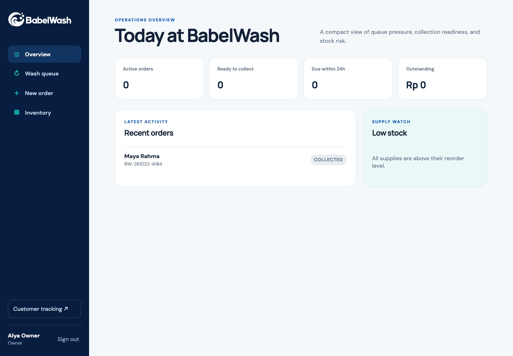
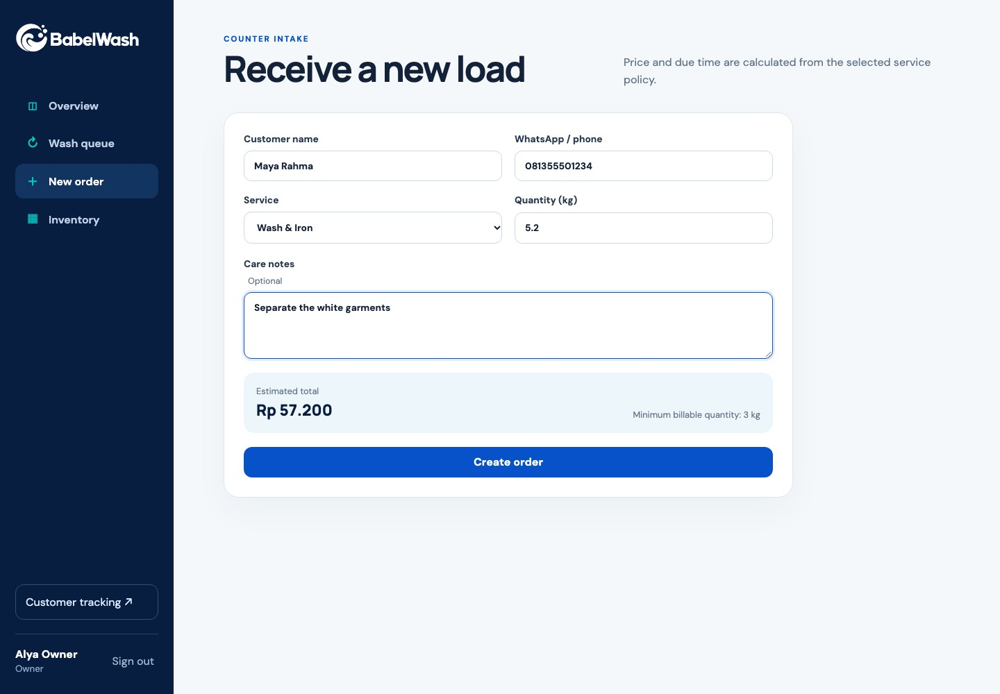
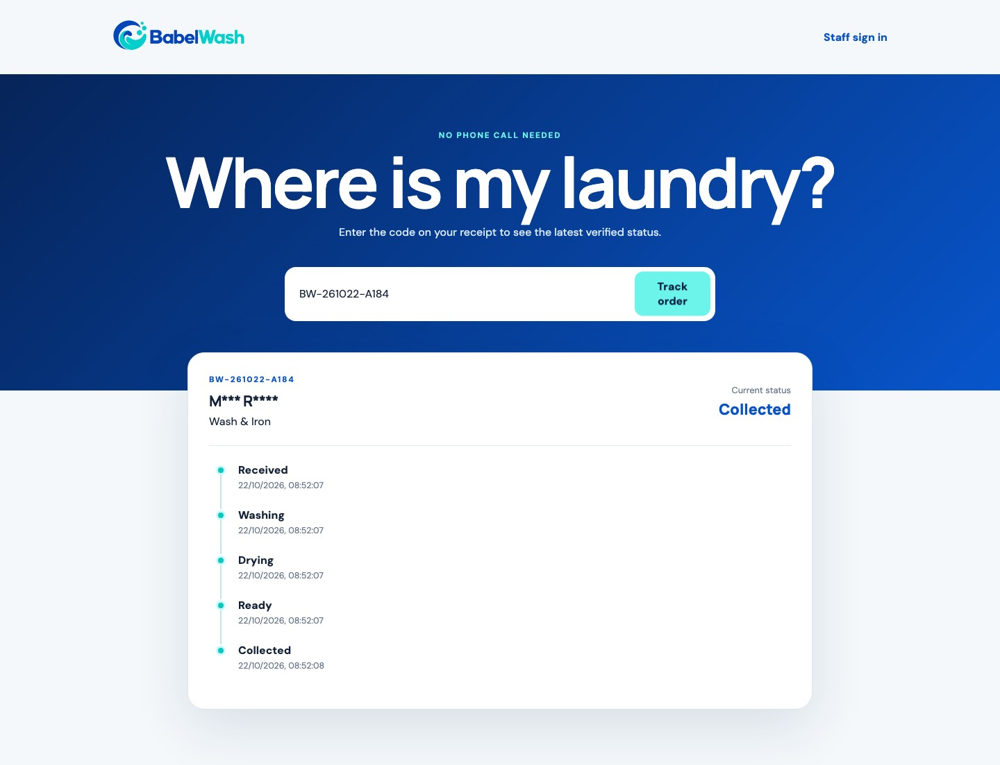
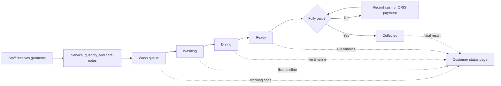
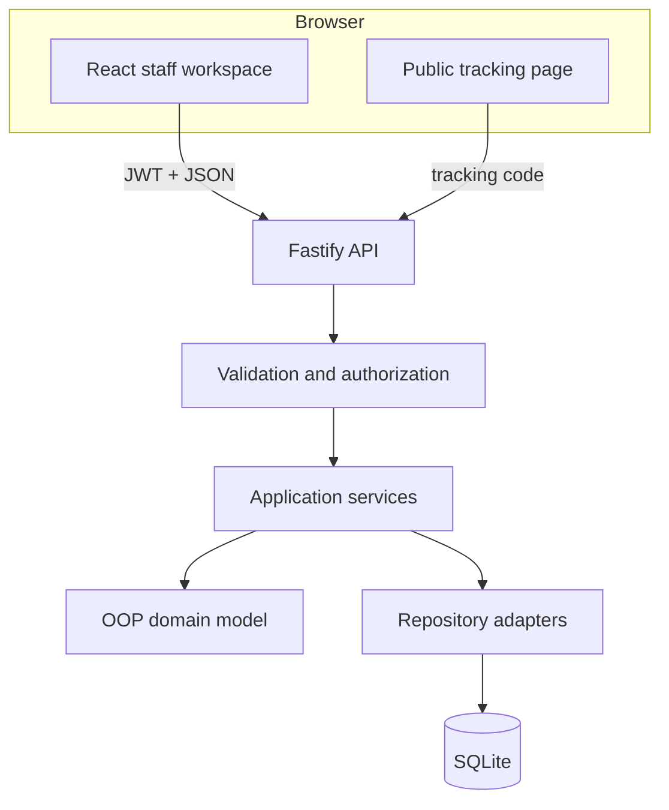

<p align="center">
  
</p>

<p align="center">
  A local-first laundry operations platform that gives every garment, payment, and handoff a visible next step.
</p>

<p align="center">
  
  
  
  
  
</p>

## The handoff is the product

A neighborhood laundry can wash clothes well and still lose customer trust between the counter, washer, dryer, payment desk, and collection shelf. Paper notes do not enforce sequence, a verbal update has no history, and a customer calling for status interrupts the same staff member who should be moving the order forward.

BabelWash turns those handoffs into one controlled workflow. Staff receive an order, move it through washing and drying, record payment, and release it only when the business rules allow it. Customers follow the same journey through a privacy-aware tracking page without entering the staff workspace.



## What the product covers

- **Role-aware workspace:** owner and staff sessions share daily operations while stock adjustments remain owner-only.
- **Order intake:** service pricing, minimum quantities, due times, contact validation, and care notes are applied consistently.
- **Controlled wash queue:** orders move through `RECEIVED → WASHING → DRYING → READY → COLLECTED`; invalid jumps are rejected by the domain model.
- **Payment gate:** cash and QRIS payments are recorded, overpayment is rejected, and an unpaid order cannot be collected.
- **Customer tracking:** a public tracking code shows the service, deadline, current state, and event timeline while masking the customer's name.
- **Inventory control:** stock movements keep an audit reason, flag reorder risk, and cannot drive quantity below zero.
- **Operational overview:** live queue counts, revenue collected, low-stock signals, and recent orders help staff decide what needs attention next.

| Staff order intake                                      | Public customer tracking                                    |
| ------------------------------------------------------- | ----------------------------------------------------------- |
|  |  |

## Product journey



## Architecture



The code is split by reason to change: HTTP routes validate transport input, application services coordinate use cases, domain objects enforce invariants, and repositories translate those decisions into SQL. See [the architecture notes](docs/architecture.md) for the component and data boundaries.

## Why this stack

| Choice              | Reason                                                                                                          |
| ------------------- | --------------------------------------------------------------------------------------------------------------- |
| TypeScript monorepo | One strict type system across domain, API, web client, and tests without duplicating contracts.                 |
| React + Vite        | Fast local feedback and a responsive client suitable for a counter computer or phone.                           |
| Fastify + Zod       | A small HTTP layer with explicit validation, structured errors, and testable request injection.                 |
| Node SQLite         | Zero-service local setup, transactional relational data, foreign keys, checks, and a database the shop can own. |
| Domain objects      | Pricing, state transitions, payment rules, and stock invariants remain independent from UI and persistence.     |
| Vitest + Playwright | Fast domain/API feedback plus proof that the same workflow works through a real browser.                        |

## Run locally

### Requirements

- Node.js 24
- pnpm 11
- A Chromium browser for the optional end-to-end test

```bash
git clone https://github.com/abiekaputra/babelwash.git
cd babelwash
pnpm install
pnpm setup:local
pnpm dev
```

Open [http://127.0.0.1:4311](http://127.0.0.1:4311).

The local seed contains fictional demonstration accounts:

| Role  | Email                   | Password     |
| ----- | ----------------------- | ------------ |
| Owner | `owner@babelwash.local` | `washday123` |
| Staff | `staff@babelwash.local` | `washday123` |

Set `BABELWASH_RESET_DATABASE=true` before `pnpm dev` when you need a clean demo database. Copy `.env.example` to `.env` and replace the JWT secret before using the product with non-demo data.

## API surface

| Method and path                       | Access        | Purpose                                   |
| ------------------------------------- | ------------- | ----------------------------------------- |
| `POST /api/session`                   | Public        | Start an owner or staff session.          |
| `GET /api/dashboard`                  | Authenticated | Read operational summaries.               |
| `GET /api/orders`                     | Authenticated | Read the active order queue.              |
| `POST /api/orders`                    | Authenticated | Receive a laundry order.                  |
| `POST /api/orders/:id/status`         | Authenticated | Apply a valid workflow transition.        |
| `POST /api/orders/:id/payments`       | Authenticated | Record a cash or QRIS payment.            |
| `GET /api/track/:code`                | Public        | Read a privacy-reduced customer timeline. |
| `GET /api/inventory`                  | Authenticated | Read stock and reorder state.             |
| `POST /api/inventory/:id/adjustments` | Owner         | Record a stock movement and its reason.   |

## Quality and validation

```bash
pnpm quality
pnpm exec playwright install chromium
BABELWASH_RESET_DATABASE=true pnpm test:e2e
```

The quality gate checks Prettier formatting, production/test file-size limits, lint rules, strict type checking, eight domain and API tests, and production builds. The Playwright test then completes the staff and customer journey through the browser and captures the product evidence.

Coverage deliberately targets rules that can lose money or trust: minimum pricing, due dates, invalid status jumps, collection before payment, overpayment, protected endpoints, name masking, owner-only inventory changes, and negative stock. Details are in [testing and validation](docs/testing.md).

## Security and data boundaries

- Passwords are derived with PBKDF2 and per-user salts; raw passwords are never stored.
- Protected routes require signed JWT sessions; inventory mutation adds an owner-role check.
- Zod validates all write requests before business logic runs.
- SQL uses prepared statements, foreign keys, check constraints, and explicit transactions for related writes.
- Public tracking returns only masked customer names and operational status fields.
- Helmet supplies browser security headers and CORS is restricted to the configured web origin.
- Demo identities and screenshots are synthetic. The repository contains no real shop or customer data.

See [SECURITY.md](SECURITY.md) for responsible disclosure and local configuration guidance.

## Status and limits

BabelWash is a complete **local portfolio release**. Its main owner, staff, and customer workflows are implemented and browser-validated on desktop and mobile viewport sizes. It intentionally has no public deployment, messaging provider, printer integration, or production backup service. QRIS is represented as a payment method recorded by staff; this release does not claim a payment-gateway integration.

Those boundaries keep the product reproducible on one machine and keep its claims aligned with the implementation. A real shop rollout would next require merchant-specific data migration, managed secrets, backup and restore, production observability, and a verified payment-provider integration.

## Documentation

- [Product scope and acceptance criteria](docs/product-scope.md)
- [Architecture and data decisions](docs/architecture.md)
- [Testing and end-user validation](docs/testing.md)
- [Engineering decisions and tradeoffs](docs/engineering-decisions.md)

## License

[MIT](LICENSE) © 2026 Abi Eka Putra Wulyono
