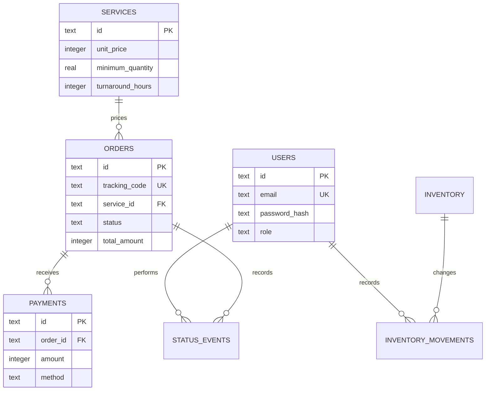

# Architecture

## Component boundaries

| Component            | Responsibility                                            | Must not decide                                        |
| -------------------- | --------------------------------------------------------- | ------------------------------------------------------ |
| React pages          | User interaction, page state, and accessible feedback     | Pricing, legal status transitions, or stock invariants |
| API client           | HTTP transport and response errors                        | Business policy                                        |
| Fastify routes       | Authentication, authorization, input schemas, HTTP status | Domain rules or raw SQL                                |
| Application services | Coordinate order use cases and persistence                | Browser presentation                                   |
| Domain package       | Pricing, lifecycle, payment, and stock invariants         | HTTP or database representation                        |
| Repositories         | Prepared SQL, records, transactions, and queries          | UI behavior                                            |
| SQLite               | Relational integrity, durable local records, and indexes  | Workflow orchestration                                 |

This separation keeps the most important rules executable without a server or browser. It also lets API integration tests use Fastify's in-process request injection against an isolated SQLite database.

## Domain model

### `LaundryOrder`

Owns service-minimum pricing, due-time calculation, the ordered state machine, payment balance, and the collection gate. A caller cannot jump directly from received to ready or collect an unpaid order.

### `Money`

Keeps currency values as integer rupiah, avoiding floating-point calculations for payment and balance rules.

### `InventoryItem`

Owns nonnegative quantity and reorder-level behavior. Persistence adds an immutable movement record for each accepted adjustment.

## Relational model

SQLite check constraints protect nonnegative prices and stock, positive quantities, and finite enum values. Foreign keys are enabled for every connection. Indexes support queue filtering and recent-order views.

## Request lifecycle

1. React sends JSON through the typed API client.
2. Fastify verifies the JWT where required.
3. Zod parses the route parameters and body.
4. The application service loads the required record.
5. A domain object accepts or rejects the requested change.
6. A repository commits the record and its audit event.
7. The API returns a reduced response; the client refreshes operational state.
8. Expected validation and domain failures become clear `400` or `409` responses; unexpected failures are logged and returned as a generic `500` message.

## Local-first decision

The product uses Node's built-in SQLite binding so a reviewer can run the complete system without Docker or external infrastructure. This improves reproducibility and fits a single-site laundry release. It also means concurrent multi-site writes, managed backups, high availability, and horizontal API scaling remain production concerns outside the current scope.
